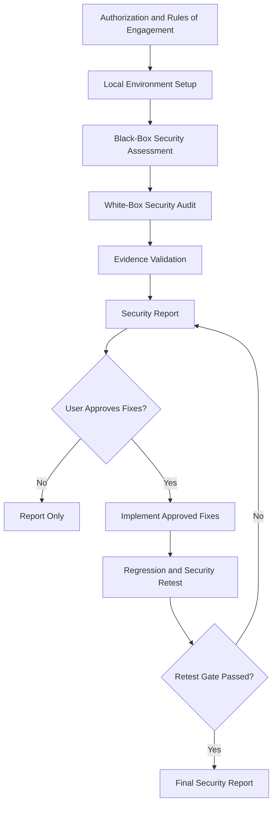

# 🛡️ RedTeam Self-Audit

### Hack yourself before the bad guys do.

An open-source, agent-agnostic cybersecurity skill that transforms your AI coding agent into an authorized security assessment team.

RedTeam Self-Audit goes beyond traditional static code analysis. It evaluates your locally running application from an attacker's perspective, validates security findings with evidence, reviews source code, generates detailed security reports, and guides approved remediation through regression testing.


---

## 🚀 Installation

Install RedTeam Self-Audit using the [Skills CLI](https://skills.sh/):

```bash
npx skills add joexamer/redteam-self-audit
```

Requires Node.js 22.20 or later for the current Skills CLI.

### Global installation

Make the skill available across your projects:

```bash
npx skills add joexamer/redteam-self-audit -g
```

### Install for a specific agent

**Claude Code**

```bash
npx skills add joexamer/redteam-self-audit -a claude-code
```

**OpenCode**

```bash
npx skills add joexamer/redteam-self-audit -a opencode
```

**Codex**

```bash
npx skills add joexamer/redteam-self-audit -a codex
```

**Cursor**

```bash
npx skills add joexamer/redteam-self-audit -a cursor
```

### Manual installation

```bash
git clone https://github.com/joexamer/redteam-self-audit.git
```

Copy the repository into your coding agent's supported skills directory.

### Updating

```bash
npx skills update
```

---

## ⚡ Quick Start

Open your project using your preferred AI coding agent after installing the skill.

Ask your agent:

> Use redteam-self-audit to perform a comprehensive security assessment of my local application. Generate an evidence-based report and propose fixes. Do not modify the application without my approval.

The agent will establish the authorized testing scope, determine the available environment capabilities, and begin the security assessment.

No external API key is required by the skill itself. Your coding agent and selected AI model may have their own requirements.

---

## 🧠 What Makes It Different?

Most AI security reviews simply read source code and suggest potential vulnerabilities.

RedTeam Self-Audit combines runtime security testing, source-code analysis, evidence validation, and controlled remediation into a structured workflow.

| Capability | Traditional code review | RedTeam Self-Audit |
|---|---|---|
| Static code analysis | ✅ | ✅ |
| Runtime security assessment | Limited | ✅ |
| Black-box testing | Usually unavailable | ✅ |
| Evidence-based findings | Varies | ✅ |
| Business logic review | Limited | ✅ |
| CVSS severity scoring | Varies | ✅ |
| Security coverage reporting | Varies | ✅ |
| Approval-based remediation | Manual | ✅ |
| Regression testing | Manual | ✅ |
| Release readiness verdict | Varies | ✅ |

Capabilities depend on the host agent, available tools, and environment isolation.

---

## 🔥 Core Features

- **Black-box-first assessment:** Evaluate application behavior without relying on source-code knowledge when isolation is available.
- **White-box security audit:** Identify security weaknesses that cannot be detected through runtime testing alone.
- **Local environment orchestration:** Work with locally running applications and isolated test environments.
- **Evidence-based reporting:** Distinguish confirmed vulnerabilities from suspected weaknesses.
- **CVSS 3.1 scoring:** Classify confirmed findings by severity.
- **Security coverage matrix:** Document what was tested, what was skipped, and why.
- **Human-approved remediation:** Require explicit approval before applying fixes.
- **Regression verification:** Verify approved fixes and identify remaining weaknesses.
- **Release verdict:** Generate a BLOCK, CONDITIONAL, or PASS assessment.
- **Agent-agnostic architecture:** Use the skill with compatible AI coding environments.

---

## ⚙️ How It Works



### Assessment stages

1. **Authorization:** Establish ownership, permitted targets, boundaries, and Rules of Engagement.
2. **Environment preparation:** Prepare a local application with isolated test data.
3. **Black-box assessment:** Evaluate externally observable application behavior.
4. **White-box audit:** Review source code, configuration, dependencies, and application logic.
5. **Validation:** Verify findings and collect supporting evidence.
6. **Reporting:** Produce a structured security assessment and remediation recommendations.
7. **Remediation:** Apply individually approved fixes.
8. **Retesting:** Verify remediation through regression and security testing, for up to three rounds.

---

## 🛡️ Security Coverage

The assessment methodology covers:

| Category | Scope |
|---|---|
| Application surface | Exposed functionality and endpoints |
| Authentication | Identity verification and account security |
| Sessions | Session and token management |
| Authorization | Access control and tenant isolation |
| Injection | Unsafe input processing |
| Client-side security | Browser-side vulnerabilities |
| Network trust | Server-side request handling |
| File handling | Upload, download, and storage security |
| Data processing | Parser and serialization security |
| Business logic | Workflow and application state integrity |
| APIs | API and real-time communication security |
| Infrastructure | Deployment and configuration weaknesses |
| Supply chain | Dependencies and exposed secrets |

Coverage is recorded in the final report. Unsupported or untested categories are explicitly disclosed.

---

## 📊 Security Reporting

The generated report includes:

- Executive summary
- Assessment scope
- Rules of Engagement
- Security score
- Release readiness verdict
- Confirmed and suspected findings
- CVSS 3.1 severity ratings
- Supporting evidence
- Business and technical impact
- CWE and OWASP mappings
- Recommended remediation
- Security coverage matrix
- Regression and retest results
- Remaining risks and limitations

### Severity classification

| Severity | CVSS 3.1 |
|---|---|
| 🔴 Critical | 9.0–10.0 |
| 🟠 High | 7.0–8.9 |
| 🟡 Medium | 4.0–6.9 |
| 🔵 Low | 0.1–3.9 |
| ⚪ None | 0.0 |

### Security scoring

The assessment starts at 100 points.

| Confirmed severity | Deduction |
|---|---:|
| Critical | −35 |
| High | −12 |
| Medium | −4 |
| Low | −1 |

Related findings are evaluated without double-counting confirmed chains. Insufficient testing coverage caps the security score.

### Release verdict

| Verdict | Meaning |
|---|---|
| 🔴 BLOCK | Significant unresolved security risks or an insufficient security score |
| 🟡 CONDITIONAL | Remaining findings, incomplete coverage, or missing runtime verification |
| 🟢 PASS | Defined remediation, coverage, and retesting criteria have been satisfied |

A PASS verdict is not a guarantee that the application is free of vulnerabilities.

---

## 🤖 Supported AI Agents

RedTeam Self-Audit follows the open Agent Skills format.

| Agent | Installation target |
|---|---|
| Claude Code | `claude-code` |
| OpenCode | `opencode` |
| OpenAI Codex | `codex` |
| Cursor | `cursor` |
| Other compatible agents | Select during installation |

The skill is not tied to a specific AI model provider.

Assessment quality depends on the selected model's reasoning capabilities, tool access, context window, and ability to follow security procedures.

Installation compatibility does not guarantee complete runtime compatibility.

---

## 📦 Requirements

### Basic requirements

- A compatible AI coding agent
- A locally accessible application
- Bash
- Python 3
- cURL
- Authorization to assess the application

### Optional capabilities

- Docker
- Git
- jq
- Node.js
- Browser automation
- Compatible security analysis tools

### Environment capability tiers

| Tier | Environment | Capabilities |
|---|---|---|
| A | Shell and Docker | Isolated runtime and source-code assessment |
| B | Shell without Docker | Host-based local assessment |
| C | No shell access | Static security review only |

If true black-box isolation is unavailable, the assessment is classified as gray-box.

---

## 📁 Repository Structure

```text
redteam-self-audit/
├── SKILL.md
├── README.md
├── LICENSE
├── VALIDATION.md
├── agents/
│   └── openai.yaml
├── references/
│   ├── roe.md
│   ├── glossary.md
│   ├── methodology.md
│   ├── report-schema.md
│   ├── remediation.md
│   ├── resources.md
│   ├── chains.md
│   └── playbooks/
├── scripts/
├── templates/
│   ├── ROE.md
│   ├── BRIEF.md
│   ├── STATE.md
│   ├── findings.schema.json
│   └── report.md
├── demo/
└── tests/
```

- `SKILL.md` — Main agent instructions.
- `references/` — Security methodology and assessment references.
- `scripts/` — Supporting validation and environment utilities.
- `templates/` — Standardized assessment and reporting templates.
- `demo/` — Deliberately vulnerable local testing fixture.
- `tests/` — Safety and behavior validation.
- `VALIDATION.md` — Documented validation results and limitations.

---

## 🧪 Validation Status

The skill has been evaluated against a deliberately vulnerable local application.

| Metric | Result |
|---|---:|
| Confirmed findings | 10 |
| Confirmed exploit chains | 3 |
| Assessment coverage | 92% |
| Refusal scenarios tested | 7 |
| Release verdict | BLOCK |

### Current validation limitations

- Local fixture assessment: validated.
- Safety refusal scenarios: passed.
- Docker-based isolation: not yet independently validated.
- OWASP Juice Shop calibration: not yet completed.
- Full remediation and retest lifecycle: not yet validated end to end.

See [VALIDATION.md](VALIDATION.md) for the complete validation details.

---

## 📚 Security Standards

The methodology draws on established application security resources, including:

- [OWASP Web Security Testing Guide](https://owasp.org/www-project-web-security-testing-guide/)
- [OWASP Top 10](https://owasp.org/www-project-top-ten/)
- [OWASP API Security](https://owasp.org/www-project-api-security/)
- [OWASP ASVS](https://owasp.org/www-project-application-security-verification-standard/)
- [CWE](https://cwe.mitre.org/)
- [CVSS](https://www.first.org/cvss/)
- [MITRE ATT&CK](https://attack.mitre.org/)
- [PortSwigger Web Security Academy](https://portswigger.net/web-security)

---

## ⚠️ Responsible Use

RedTeam Self-Audit is designed exclusively for authorized, defensive cybersecurity assessments.

- Assess only local or private test environments that you own or have explicit written authorization to test.
- Establish Rules of Engagement before beginning.
- Use synthetic test data instead of production data.
- Do not target public or third-party infrastructure.
- Do not perform destructive operations, denial-of-service testing, persistence, or external data exfiltration.
- Obtain explicit approval before modifying application code.
- Review generated reports and remediation recommendations before relying on them.

The skill is not a replacement for professional penetration testing, independent security reviews, or security certification.

---

## 🗺️ Roadmap

- [x] Agent Skills-compatible architecture
- [x] Structured security assessment methodology
- [x] Local application assessment
- [x] Evidence-based reporting
- [x] CVSS scoring
- [x] Local fixture validation
- [x] Safety refusal testing
- [ ] OWASP Juice Shop calibration
- [ ] End-to-end remediation lifecycle validation
- [ ] Cross-agent compatibility testing
- [ ] CI/CD integration
- [ ] Additional application framework validation

---

## 🤝 Contributing

Contributions are welcome.

You can help improve:

- Security assessment accuracy
- Agent compatibility
- Reporting quality
- Framework compatibility
- Test coverage
- Environment isolation
- Documentation

Open an [issue](https://github.com/joexamer/redteam-self-audit/issues) or submit a pull request.

---

## 📄 License

Released under the [MIT License](LICENSE).

---

## 👨‍💻 Author

Created by [@joexamer](https://github.com/joexamer).

If you find this project useful, consider giving it a ⭐ on GitHub.

```bash
npx skills add joexamer/redteam-self-audit
```

**Hack yourself before the bad guys do.**
